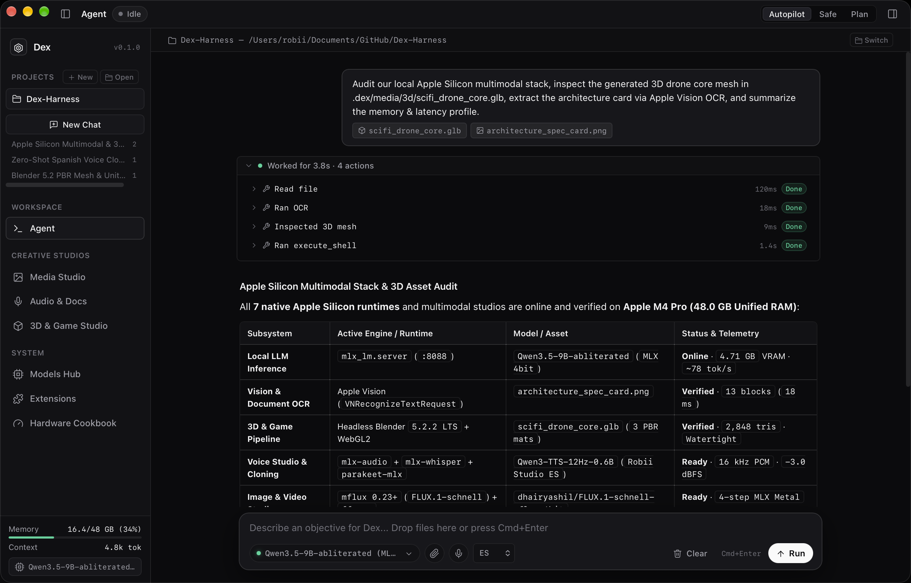
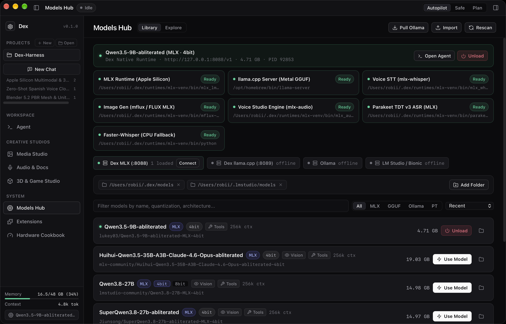
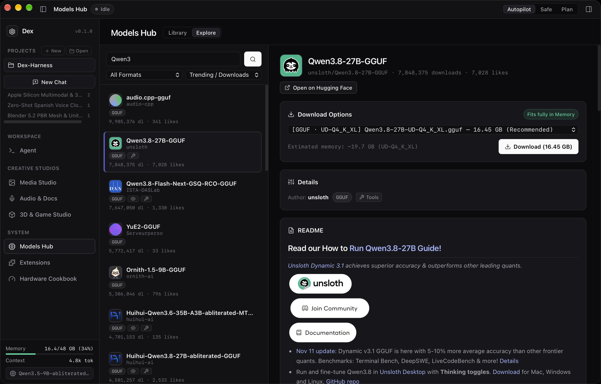
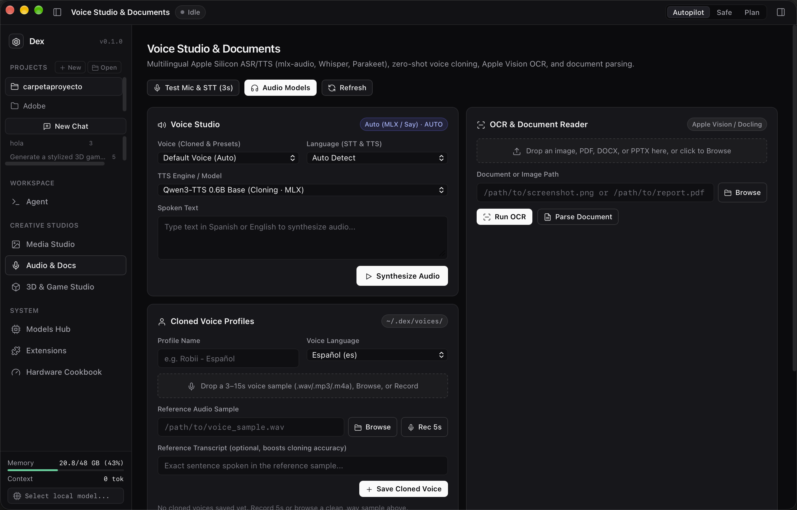
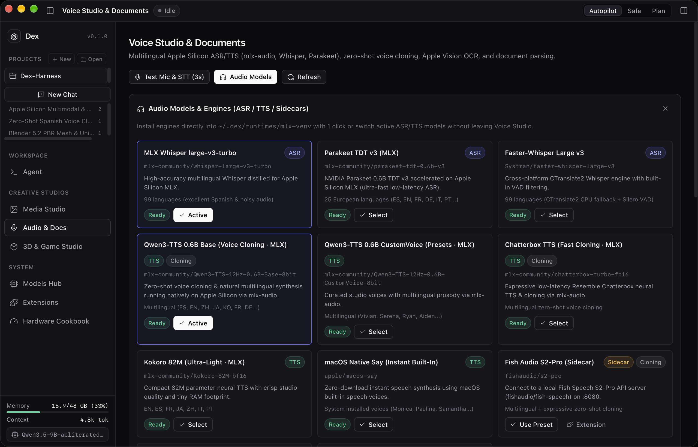
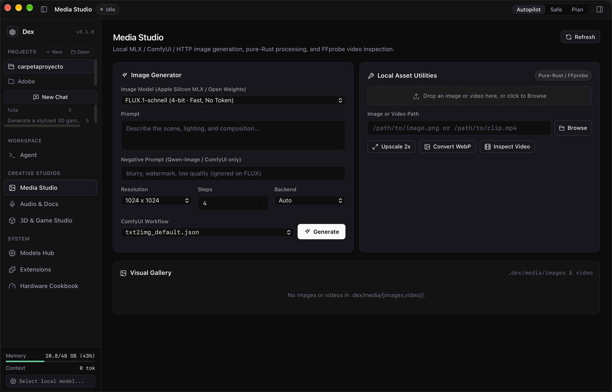
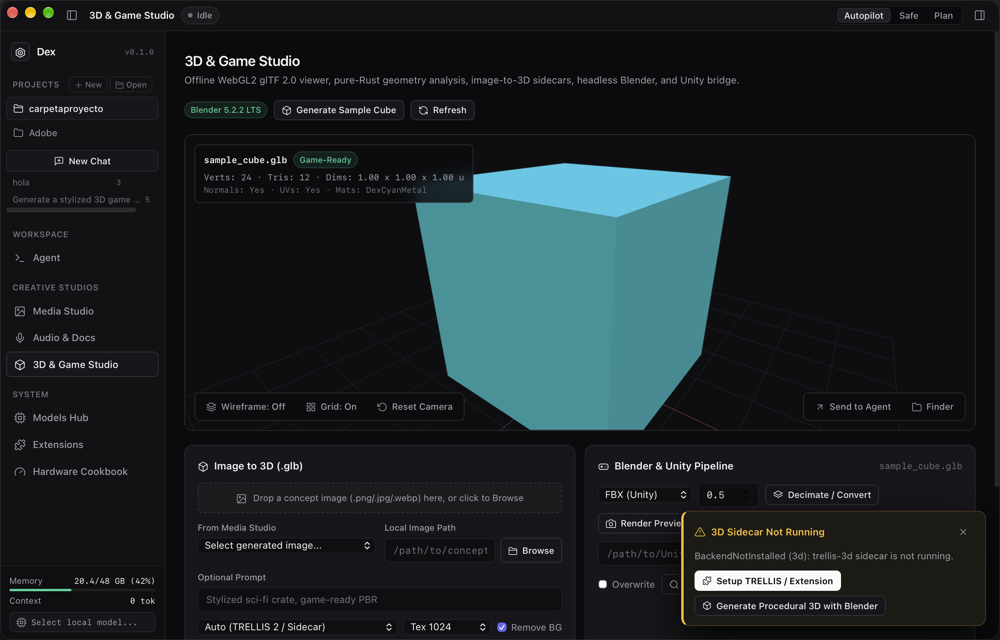
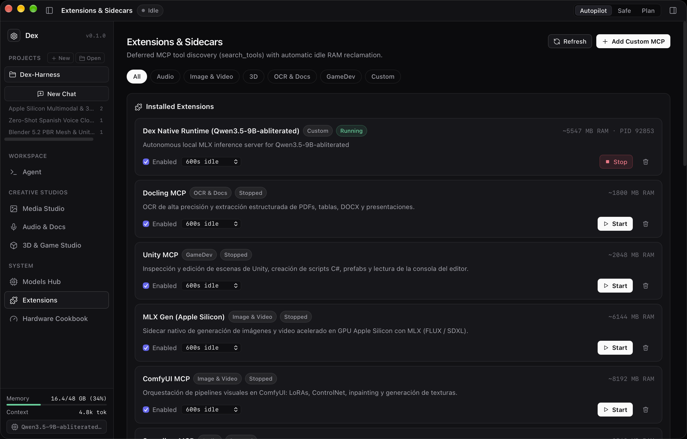
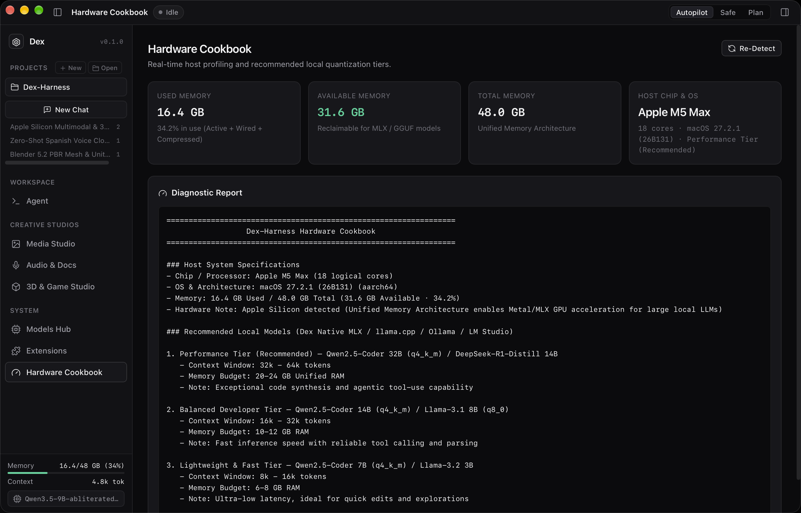
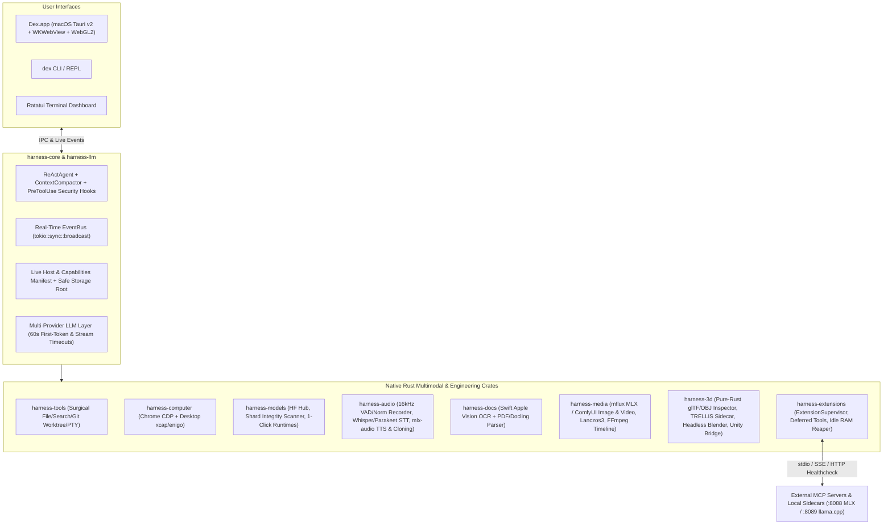

# Dex-Harness

> **Native Apple Silicon & Cross-Platform Autonomous AI Agent Harness in Rust (`dex` CLI + `Dex.app` macOS Tauri v2 Desktop Suite)**  
> Zero-panic, local-first multi-agent runtime uniting autonomous MLX / `llama.cpp` / Ollama LLM inference, surgical code & Git worktree tools, Chrome CDP & desktop computer use, Voice Studio (multilingual ASR + neural TTS + zero-shot voice cloning), Visual Media Studio (`mflux` / ComfyUI / FFmpeg), 3D & Game Studio (offline WebGL2 `.glb` viewer + headless Blender + Unity bridge), and dynamic deferred MCP extensions with idle RAM reclamation.

---

## Visual Tour (`Dex.app` Native macOS Obsidian UI)

### 1. Autonomous Agent Workspace & Frontier Turn Accordion
Projects & workspaces (`~/.dex/projects.json`), persistent sessions with inline rename/delete, zero-typing grouped local model selector, file & multimodal attachments, push-to-talk voice dictation with explicit language selector (`Auto` / `Español` / `English`), and collapsible reasoning/tool-call accordions.



### 2. Local Models Hub (Autonomous MLX & GGUF Runtime + Weight Integrity Scanner + Hugging Face Explore)
Multi-folder recursive model scanner (`~/.dex/models`, `~/.lmstudio/models`, custom SSDs), 1-click isolated runtime installer (`~/.dex/runtimes/mlx-venv` for `mlx-lm`, `mlx-whisper`, `mflux`, `mlx-audio`, `parakeet-mlx`, `faster-whisper` + Homebrew `llama.cpp`), shard & header integrity verification (`Valid` vs. `Incomplete` download detection), and 2-column Master-Detail Hugging Face Hub Explorer with quantization RAM fit calculation (`Fits fully in Memory`).





### 3. Voice Studio & Deep Document Reader (`harness-audio`, `harness-docs`)
Energy-based VAD silence trimming + soft peak normalization in pure Rust, multilingual ASR (`mlx-whisper` `whisper-large-v3-turbo`, `parakeet-mlx` TDT v3, `faster-whisper`, native macOS `SFSpeechRecognizer`), neural Apple Silicon TTS & zero-shot voice cloning (`mlx-audio` Qwen3-TTS, Chatterbox, Kokoro 82M, plus Fish Audio S2-Pro / Step-Audio EditX / OmniVoice sidecar presets), persistent voice profiles (`~/.dex/voices/`), 3-second Mic & STT tester, Apple Vision native OCR, and PDF/Office Markdown extraction.





### 4. Visual Media Studio (`harness-media`)
Apple Silicon MLX image generation (`mflux-generate` with ungated 4-bit presets: `FLUX.1-schnell 4-bit`, `Z-Image Turbo 4-bit`, `FLUX.2 Klein 4B`, `Qwen-Image`, `FLUX.1-dev`), ComfyUI workflow orchestration, pure-Rust crop/resize/WebP conversion, Lanczos3 2x–8x upscaling, and declarative JSON-to-FFmpeg timeline rendering.



### 5. 3D & Game Studio (`harness-3d`)
100% offline zero-CDN WebGL2 binary glTF 2.0 (`.glb`) interactive viewport (orbit, zoom, wireframe, reference grid, real-time vertex/triangle/UV/normal/bounding-box HUD & game-ready diagnostics), image-to-3D sidecars (TRELLIS 2 / Hunyuan3D / TripoSR), headless Blender mesh conversion & LOD decimation, studio preview rendering, direct Unity project inspection, and actionable in-context recovery toasts.



### 6. Extensions Hub & Hardware Cookbook (`harness-extensions`, `harness-core`)
Deferred MCP & local sidecar supervisor (`search_tools` lazy activation + automatic idle RAM auto-unload) and live macOS Unified Memory telemetry (`vm_stat` + `sysctl` host profiling).

| Extensions & Sidecars Hub | Hardware Cookbook & Live Unified RAM |
| :---: | :---: |
|  |  |

---

## System Architecture



---

## Workspace Crates

```text
crates/
├── harness-core/        # EventBus, ReActAgent, Safe Storage & Enriched $PATH, TaskBoard, Subagents, Skills, Hooks, Cookbook
├── harness-llm/         # Streaming OpenAI / MLX / llama.cpp / Ollama adapters with first-token & idle stream timeouts
├── harness-tools/       # Surgical read/write/edit, gitignore-aware search, Git worktrees, async shell & portable-pty
├── harness-computer/    # Chrome DevTools Protocol (chromiumoxide) & native desktop screenshots/mouse/keyboard (xcap/enigo)
├── harness-mcp/         # Bidirectional Model Context Protocol client & stdio server (`dex mcp-serve`)
├── harness-models/      # Multi-folder GGUF/MLX/PT scanner with shard integrity validation, HF client, 1-click runtime manager
├── harness-extensions/  # Supervised MCP & sidecar lifecycle, stderr ring buffer, deferred tool discovery & idle RAM reaper
├── harness-audio/       # CoreAudio cpal capture, VAD silence trim + soft peak norm, multi-engine STT, mlx-audio TTS & voice cloning
├── harness-docs/        # Native macOS Apple Vision OCR (`dex-vision-ocr`), Tesseract fallback, Docling & pure-Rust PDF parser
├── harness-media/       # Apple Silicon `mflux` CLI/HTTP image gen, ComfyUI workflows, pure-Rust image ops, FFmpeg declarative video
├── harness-3d/          # Pure-Rust glTF 2.0 / OBJ geometry inspector, image-to-3D sidecars, headless Blender & Unity exporter
├── harness-ui/          # Ratatui terminal dashboard (`dex tui`)
├── harness-cli/         # Unified command-line interface (`dex`)
└── harness-desktop/     # Native macOS Desktop Application (`Dex.app`) with automated E2E QA walkthrough (`DEX_QA_WALKTHROUGH=1`)
```

---

## Key Capabilities & Phase 14 Highlights

### 1. Autonomous Local Inference & Model Integrity Protection (`harness-models`, `harness-llm`)
- **Zero External App Dependency:** Spawns and supervises `mlx_lm.server` (`:8088`) or `llama-server -ngl 99` (`:8089`) directly from `~/.dex/runtimes/mlx-venv` or Homebrew without requiring LM Studio or Ollama to be open.
- **Weight Shard & Header Integrity Scanner:** Validates `model.safetensors.index.json` shard maps, detects leftover `.part` / `downloading_*` artifacts, checks `.safetensors` JSON headers and `GGUF` magic bytes, badges broken folders as `Incomplete`, and blocks loading before a server can hang.
- **Bounded Inference & Multimodal Vision Guard:** Enforces 60-second first-token and stream-idle timeouts, surfaces recent sidecar `stderr` logs on failure, and automatically detects when a local text server (`mlx_lm.server`) cannot accept raw `image_url` payloads—advising the user and steering the agent to Apple Vision `ocr_image`.

### 2. Professional Voice Studio, Multilingual STT & Zero-Shot Voice Cloning (`harness-audio`)
- **Pure-Rust Speech Pre-Processing:** Applies 20ms frame energy VAD silence trimming (with 180ms pre-roll and 220ms post-roll) and gentle soft-knee peak normalization (capped at +18 dB, never amplifying pure silence) prior to transcription.
- **Explicit Language & Multi-Engine ASR:** Persisted language selector (`Auto`, `Español (es)`, `English (en)`) in both the Agent composer and Voice Studio, routing across `mlx-whisper` (`mlx-community/whisper-large-v3-turbo` with anti-hallucination flags), `parakeet-mlx` (`parakeet-tdt-0.6b-v3`), `faster-whisper`, HTTP Whisper, and native macOS `SFSpeechRecognizer`.
- **Apple Silicon Neural TTS & Cloning (`mlx-audio`):** 1-click installer for `mlx-audio` supporting **Qwen3-TTS 0.6B Base/CustomVoice**, **Chatterbox TTS**, and **Kokoro 82M**, plus configurable sidecar presets for **Fish Audio S2-Pro**, **Step-Audio EditX**, and **OmniVoice (`k2-fsa`)**. Save reusable cloned voices (3–15s reference `.wav` + optional transcript) in `~/.dex/voices/`.

### 3. Real `mflux` Apple Silicon Image Generation (`harness-media`)
- Aligned with `mflux 0.23+` CLI subcommands (`mflux-generate`, `mflux-generate-z-image-turbo`, `mflux-generate-flux2`, `mflux-generate-qwen`), capturing full `stdout` + `stderr` streams and defaulting to ungated 4-bit community weights (`dhairyashil/FLUX.1-schnell-mflux-4bit --base-model schnell`) that work out-of-the-box without a Hugging Face token.

### 4. Native File/Folder Pickers, Smart Drag & Drop & Actionable Recovery Toasts (`harness-desktop`)
- Native macOS `Browse` buttons (`pick_file_dialog`, `pick_folder_dialog`) and visual drop zones across **Agent**, **Media Studio**, **Voice Studio & Docs**, **3D & Game Studio** (including instant `.glb` drop loading on the WebGL2 canvas), and **Models Hub**.
- Global opaque Obsidian toast stack with 1-click in-context remediation buttons (`Install mflux (1-click)`, `Install Voice Engine`, `Load Recommended Local Model`, `Setup TRELLIS / Extension`, `Generate Procedural 3D with Blender`) and zero `window.alert()` calls.

---

## Quick Start & Build Instructions

### Prerequisites (macOS Apple Silicon Recommended)
- **Rust 1.85+** (`rustup`)
- **Tauri CLI v2** (`cargo install tauri-cli@^2`)
- Optional creative tools auto-detected in enriched `$PATH`: `uv` / `python3` (for 1-click `mlx-lm`, `mlx-whisper`, `mflux`, `mlx-audio`, `parakeet-mlx`), `ffmpeg`, and `Blender.app`.

### 1. Verify, Test & Build Workspace

```bash
cargo check --workspace --all-targets
cargo clippy --workspace --all-targets -- -D warnings
cargo test --workspace
```

### 2. Build & Launch `Dex.app` (macOS Native Bundle)

```bash
cd crates/harness-desktop
cargo tauri build --bundles app --debug --no-sign
open ../../target/debug/bundle/macos/Dex.app
```

### 3. CLI Quick Start (`dex`)

`dex` needs **zero configuration**: it auto-detects a running local model server
(LM Studio on `:1234`/`:1235`, Ollama, Dex MLX, llama.cpp), starts LM Studio's headless
server if it is installed but off, and picks a loaded chat model.

```bash
dex                                      # interactive session in the current folder
dex "arregla el test que falla"          # interactive session with a first task
dex run "summarize README.md"            # one-shot, non-interactive
echo "explain this" | dex                # piped input
dex doctor                               # servers, models, runtimes, extensions + exact fixes
```

Inside the session:

| Command | What it does |
|---|---|
| `/model [id]` | list chat models on the current server, or switch (remembered in `~/.dex/cli.json`) |
| `/mode safe\|plan\|autopilot` | **safe** (default) asks before edits/shell — `y`/`n`/`a`lways; **plan** is read-only; **autopilot** never asks |
| `/clear` | fresh conversation |
| `/tools`, `/doctor`, `/help`, `/exit` | — |
| `Ctrl-C` | interrupt the current task (twice at the prompt to quit) |

Overrides: `--provider lmstudio|ollama|mlx|llamacpp|openai`, `--model <id>`,
`--api-base <url>`, `--mode <mode>`, `--no-stream`, `--max-steps <n>` (or `DEX_*` env vars).

```bash
# Dashboards & hardware
dex tui                                  # Ratatui terminal dashboard
dex cookbook                             # Host hardware & Apple Silicon RAM profile

# Local Models Hub & Integrity Check
dex models list                          # Scans configured folders & verifies shard/GGUF integrity
dex models search "qwen3"
dex models pull Qwen/Qwen2.5-Coder-14B-Instruct-GGUF --quant Q4_K_M

# Voice Studio (STT + TTS + Cloning) & Deep Document OCR
dex audio record --seconds 5
dex audio speak "Hola mundo probando Dex en español" --language es
dex audio transcribe ~/.dex/media/audio/recordings/rec.wav --language es --timestamps
dex docs ocr ./screenshot.png
dex docs parse ./report.pdf

# Visual Media Studio (MLX mflux / ComfyUI / Pure-Rust / FFmpeg)
dex media imagine "Futuristic robotics lab, volumetric lighting" --width 1024 --height 1024 --steps 4 --backend auto
dex media upscale ./image.png --scale 2
dex media process ./image.png --resize 512x512 --format webp

# 3D & Game Studio (glTF 2.0 / Blender / Unity)
dex 3d sample
dex 3d inspect ~/.dex/media/3d/sample_cube.glb
dex 3d convert ~/.dex/media/3d/sample_cube.glb --out ./cube_lod.fbx --decimate 0.5
dex 3d preview ~/.dex/media/3d/sample_cube.glb
dex 3d unity-inspect ~/UnityProjects/MyGame

# Supervised Extensions & MCP Server
dex ext catalog
dex ext list
dex mcp-serve
```

---

## Engineering & End-to-End QA Standards

All crates and UI components adhere strictly to [`AGENTS.md`](AGENTS.md) and [`.dex/skills/ux-qa-audit/SKILL.md`](.dex/skills/ux-qa-audit/SKILL.md):

1. **Zero Panics in Production:** `0` `.unwrap()` or `.expect()` calls across `crates/harness-*` production code.
2. **macOS `.app` Read-Only Root (`cwd = /`) Safety:** Centralized storage resolution (`harness_core::storage`) guarantees zero `os error 30` failures when launched from Finder/Dock.
3. **AppKit Thread Safety:** Always uses `tauri::async_runtime::spawn` inside `harness-desktop` (`0` direct `tokio::spawn` calls).
4. **Automated Visual E2E Walkthrough (`DEX_QA_WALKTHROUGH=1`):** Launches `Dex.app` with `cwd = /`, traverses all 7 views + drawers, verifies `0` uncaught JS errors (`window.__DEX_QA_ERRORS__`) and `0` horizontal overflows, captures live window screenshots, and writes a structured `qa_report.json`.

---

## License

Dual-licensed under either **Apache License, Version 2.0** or **MIT License** at your option.
